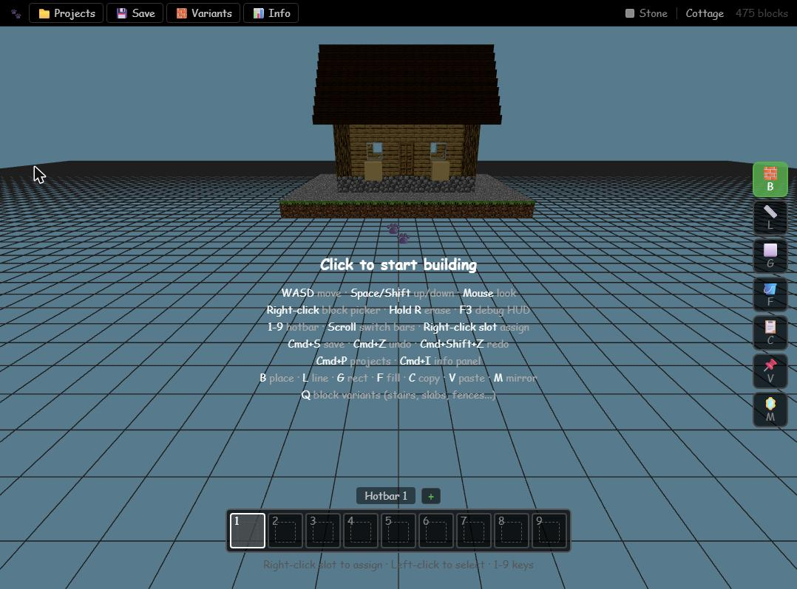
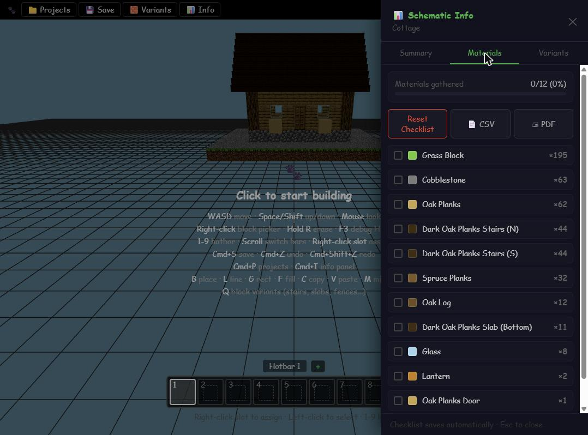

# 🐾 Pawprint

**A Minecraft schematic builder that runs in your browser.** You build in first person with real block textures, and get a material shopping list and a `.litematic` file you can load in-game.

**Live: https://pawprint.jamiecahn.com**

Pawprint, made by [Jamie Cahn](https://jamiecahn.com).



---

## What it does

- **Build in 3D, first person.** Fly around with WASD and the mouse, then place and erase blocks the way you would in Minecraft. There are 278 blocks in 15 categories, drawn with Minecraft 1.21.4 textures.
- **Block variants.** Slabs, stairs (by facing), walls, fences, fence gates, doors, trapdoors, pressure plates, buttons and carpets, picked from a variant menu.
- **Power tools.** Line, rectangle, flood fill, copy/paste of a region and X/Z mirror, with undo/redo for the last 100 actions.
- **Project library in the browser.** Save, load, rename and delete builds. They auto-save every 60 seconds and are stored locally in your browser. Nothing is uploaded.
- **Export to Litematica.** Download a `.litematic` for Minecraft 1.21.4 or 1.20.4 with correct blockstates for variants, or a native `.pawprint` JSON file.
- **Material list.** Shows block counts, dimensions and a variant breakdown, with a "materials gathered" checklist and CSV or print/PDF export.



## Why I built it

I built Pawprint to learn how to make games that run in the browser with TypeScript, and a Minecraft schematic builder turned out to be a fun way to do it: real-time 3D, a block palette, undo history and file export. I'm still actively updating it as new ideas come up.

## How to use it

1. Open the site and click **Open Editor**.
2. Click the 3D view to start building. This captures the mouse. Press **Esc** to release it.
3. Move with **WASD**, use **Space** / **Shift** for up and down, and the mouse to look around.
4. **Right-click** to open the **Block Picker**. Search or filter by category, then click a block to select it. To assign a block to a hotbar slot, right-click that slot, or drag a block onto it. Use **1–9** to switch slots, the mouse wheel to switch hotbars, and **+** to add a hotbar.
5. With the Place tool (**B**), **left-click** places a block. Hold **R** and left-click to erase.
6. Press **Q**, or click **🧱 Variants** in the menu bar, to choose a shape (slab, stairs, fence, door, …) for the selected block.
7. Pick a tool from the right-hand toolbar, or press its key:
   **B** Place · **L** Line · **G** Rectangle · **F** Fill · **C** Copy · **V** Paste · **M** Mirror.
   Line, Rectangle and Copy take two clicks: Point A, then Point B. **Esc** returns to Place.
8. Click **💾 Save** (Ctrl/Cmd+S) and give the project a name.
9. Open **📁 Projects** (Ctrl/Cmd+P). Find your build, click **Export ▾**, and choose **.litematic 1.21.4**, **.litematic 1.20.4** or **.pawprint**.
10. Open **📊 Info** (Ctrl/Cmd+I) for the **Summary**, **Materials** and **Variants** tabs. The Materials tab has the checklist and **CSV** / **PDF** buttons.

Undo is **Ctrl/Cmd+Z**, redo is **Ctrl/Cmd+Shift+Z** or **Ctrl/Cmd+Y**, and **F3** toggles a debug HUD with your position and the build's bounds.

## Run it locally

**Prerequisites**

- Node.js 20 or newer. The Docker image uses `node:20-alpine`, and the commands below were verified with Node 24.
- npm
- Optional, for block textures: `bash`, `curl`, `python3` and `unzip`

```bash
git clone https://github.com/jcahnProgramming/pawprint
cd pawprint
npm ci
```

**Block textures.** Textures are not committed to the repo. Without them the editor still runs, but blocks render untextured. To download them from Mojang's public CDN (it fetches the Minecraft 1.21.4 client jar, about 28 MB, and extracts the block PNGs into `public/textures/blocks/`), run:

```bash
./scripts/download-textures.sh
```

`scripts/extract-textures.sh` does the same from a local Minecraft install, but its path is hard-coded for macOS.

**Development**

```bash
npm run dev        # http://localhost:3000
npm run lint       # ESLint CLI (eslint.config.mjs); fails on any error or warning
npx tsc --noEmit   # type-check
```

`npm run build` runs the lint first and then the Next.js build, which type-checks. It fails if either step reports a problem.

**Production build**

```bash
npm run build
node .next/standalone/server.js
```

The app is built with `output: 'standalone'`. `npm run start` (`next start`) still serves the app, but Next.js warns that it doesn't support standalone output. The Docker image runs `node server.js` from the standalone folder. If you run the standalone server outside Docker, first copy `public/`, `.next/static/` and `CHANGELOG.json` into `.next/standalone/` (the Dockerfile does this for you). `GET /api/health` returns `{ "ok": true, "version": "…" }`, with the version taken from `CHANGELOG.json`.

No environment variables are required. The app has no backend, API keys or database.

## Run it with Docker

```bash
docker compose up -d --build
```

Then open **http://localhost:3010**.

Pushes to `main` deploy automatically on the author's server through Gitea Actions.

The image is a multi-stage build. It installs dependencies, downloads the 1.21.4 textures at build time (so the build needs internet access), builds Next.js and runs the standalone server as a non-root user on port **3010**.

**Why `HOSTNAME=0.0.0.0`?** Docker sets `HOSTNAME` inside a container to the container ID. The Next.js standalone server reads `HOSTNAME` as the address to bind to, so without the override it listens only on the IP of the container's first Docker network. Requests arriving on any other network, such as from a reverse proxy or tunnel, are refused. Setting `HOSTNAME=0.0.0.0` makes it listen on all interfaces.

**Networks.** `docker-compose.yml` also attaches the container to an external network called `supabase_default`, so that it shares a network with the tunnel that serves the live site. That network has to exist already. If you're running Pawprint on your own machine, either create it first (`docker network create supabase_default`) or delete the `tunnel` network entries from the compose file.

## Tech stack

| Area | What |
|---|---|
| Language | TypeScript 5 |
| Framework | Next.js 15.5 (App Router), React 19 |
| 3D | three.js 0.183, @react-three/fiber 9, @react-three/drei 10 |
| State | Zustand 5 |
| Storage | IndexedDB via `idb` 8, plus `localStorage` for the material checklist |
| File formats | Hand-written NBT writer for `.litematic`, gzip via `pako` |
| Styling | Inline styles. Tailwind CSS 3 is installed but barely used |
| Deployment | Docker (multi-stage, `node:20-alpine`), Docker Compose |

## Project structure

```
app/                 Next.js routes: landing page (/) and the editor (/editor)
components/          Shared UI (the "made by" credit)
components/editor/   Editor UI: 3D scene, block meshes, toolbar, hotbar, picker, panels, HUD
lib/                 Block catalogue, variants and geometry, textures, file formats,
                     .litematic NBT writer, IndexedDB project store, material stats
store/               Zustand editor store: blocks, tools, hotbars, undo/redo, projects
scripts/             Texture download/extract scripts
docs/                README screenshots
Dockerfile           Multi-stage production image
docker-compose.yml   Runs the image on port 3010
```

## FAQ

**Which file formats can I import and export?**
Export: `.pawprint` (Pawprint's own JSON) and `.litematic` for Minecraft 1.21.4 or 1.20.4. Import: `.pawprint` only. The import dialog also accepts `.litematic`, `.schem` and `.schematic`, but these currently return a "coming soon" message. `.schem`/`.schematic` export is listed in the menu but disabled. (See `lib/fileFormats.ts`.)

**Where are my builds saved?**
In your browser's IndexedDB (database `pawprint`). Nothing is sent to a server, so projects stay on that browser and device. Clearing site data deletes them. To move a build to another device, export it as `.pawprint` and import it there.

**Does it auto-save?**
Yes, every 60 seconds, but only once a project has been saved and named. A new, unsaved build isn't auto-saved until you click **Save**.

**Does export include unsaved changes?**
No. Export works from the saved copy in the Projects list, so save first.

**Which browsers work?**
You need a desktop browser with WebGL, Pointer Lock and IndexedDB (current Chrome, Edge or Firefox). It's built around a keyboard and mouse. There are no touch controls, so phones and tablets won't work well.

**Is there a size limit?**
There's no hard limit on build size, and the floor grid is 100×100. Fill stops at 10,000 blocks per click, and the line/rectangle preview shows up to 5,000 blocks. Each block is rendered as its own mesh, so very large builds will slow down.

**Can I use it offline?**
Not as an installed app (there's no service worker). Once the editor has loaded, building, saving and exporting all happen in the browser without server calls, but block textures load on demand, so a cold start needs the server.

**Is there an account or login?**
No. There are no accounts, no backend and no analytics in the code.

## Known limitations

- `.litematic`, `.schem` and `.schematic` **import** isn't implemented yet, and neither is `.schem` / `.schematic` **export** (they're stubs in `lib/fileFormats.ts`).
- Mirror reflects the **whole build** (not a selection) across its own bounding box and adds the reflected copy. Mirrored blocks lose their variant shape (they become full blocks).
- Aiming at the lower part of a block near the ground can target the ground grid instead, so Fill or Erase does nothing. Aim at the block's top or upper half.
- Export uses the last saved copy of a project, not unsaved edits.
- The Materials checklist is stored once per browser, not per project, so it carries over between projects.
- There are no automated tests.

## Built with AI

Built with [Claude Code](https://claude.com/claude-code) from product specs I wrote.

## License

No license file yet. All rights reserved by default.

---

*Minecraft is a trademark of Mojang Studios. Pawprint is not affiliated with Mojang or Microsoft. Block textures are downloaded from Mojang's servers at build time and aren't included in this repository.*
